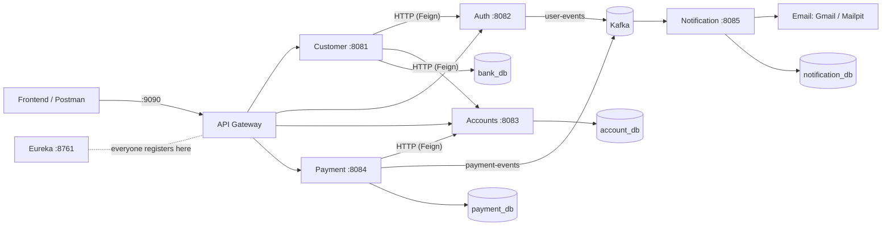

This Project is Owned By Prakhar Agrawal . Copy right reserved .

# ArthGrid — banking backend (Spring Boot microservices)

A small digital bank: customers sign up, get an account, deposit/withdraw, transfer money to each other,
pay bills, and get emails for all of it. It is built as **7 separate Spring Boot apps** that talk to each
other over HTTP and Kafka, with MySQL for storage.

- [1. Mental model](#1-mental-model-mern-edition)
- [2. Run it locally](#2-run-it-locally)
- [3. Test it](#3-test-it)
- [4. How the main flows work](#4-how-the-main-flows-work)
- [5. Spring Boot decoder for MERN devs](#5-spring-boot-decoder-for-mern-devs)
- [6. What every file does](#6-what-every-file-does)
- [7. Local mode vs cloud mode](#7-local-mode-vs-cloud-mode)
- [8. Troubleshooting](#8-troubleshooting)
- [9. Known quirks](#9-known-quirks-in-the-business-logic)

---

## 1. Mental model (MERN edition)

Imagine your usual Express backend, but instead of one `server.js` with many routers, **each router became its
own server with its own database**. A front door (the gateway) forwards requests to the right one.



| Piece | What it is | MERN equivalent |
|---|---|---|
| **API Gateway** (:9090) | Single entry point. `/customer-service/...` → Customer service, etc. | An nginx / `http-proxy-middleware` in front of your APIs |
| **Customer service** (:8081) | Sign-up + customer profiles | `routes/customers.js` |
| **Auth service** (:8082) | Creates the login user (in Auth0) | Your `auth` controller that creates a user in Firebase/Auth0 |
| **Accounts service** (:8083) | Bank accounts, balance, deposits, withdrawals, *holds* | `routes/accounts.js` |
| **Payment service** (:8084) | Transfers + bill payments, built on top of Accounts | `routes/payments.js` that calls the accounts API with axios |
| **Notification service** (:8085) | Listens to Kafka and sends emails | A background worker (like a BullMQ worker) |
| **Eureka** (:8761) | Phone book: every service registers its address | No direct equivalent; like a service registry in k8s |
| **Kafka** | Message queue / event bus between services | Redis pub/sub, BullMQ, RabbitMQ |
| **MySQL** | 4 databases, one per service | MongoDB (but SQL tables instead of collections) |

**Two ways services talk:**
- **Sync (HTTP)** — "I need an answer now": Customer → Auth, Customer → Accounts, Payment → Accounts. Done with *Feign*, which is basically a typed axios client.
- **Async (Kafka)** — "FYI, this happened": Auth and Payment publish events; Notification consumes them and sends emails. Nobody waits for the email.

**The one banking idea to know — holds:** to move money safely, Payment first puts a **hold** on the money
(reserved, can't be spent twice), then either **captures** it (money actually leaves) or **releases** it (money comes back).
`available balance = current balance − active holds`.

---

## 2. Run it locally

You only need **Docker Desktop**. No Java, no Maven, no MySQL install, no Auth0/Gmail/Aiven accounts.

> Give Docker at least **6 GB RAM** (Docker Desktop → Settings → Resources). It runs 7 JVMs + MySQL + Kafka.

```bash
git clone https://github.com/Black-Jade0/ArthGrid.git
cd ArthGrid
docker compose up --build
```

The first run takes **5–15 minutes** (Maven downloads libraries for all 7 services inside Docker).
Later runs take under a minute. It's ready when the logs calm down and you see lines like
`Started CustomerServiceApplication`.

| Open this | For |
|---|---|
| http://localhost:9090 | API Gateway — send all your requests here |
| http://localhost:8025 | **Mailpit** — every email the app "sends" lands here (welcome mail, debit/credit alerts) |
| http://localhost:8090 | Kafka UI — see the `user-events` and `payment-events` topics and messages |
| http://localhost:8761 | Eureka dashboard — which services are up |
| `localhost:3307` (user `root`, pw `root`) | MySQL — connect with MySQL Workbench / DBeaver / TablePlus |

Useful commands:

```bash
docker compose up -d --build            # run in background
docker compose ps                       # what's running
docker compose logs -f payment-service  # follow one service's logs
docker compose up -d --build accounts-service   # rebuild ONE service after changing its code
docker compose down                     # stop everything (data kept)
docker compose down -v                  # stop + wipe the database
```

### Option B — run services from IntelliJ / terminal (for development)

Use this when you want to edit Java code and restart quickly. Needs **JDK 21**.

1. Start only the infrastructure in Docker:
   ```bash
   docker compose up -d mysql-db kafka kafka-ui mailpit
   ```
2. Start each service in its own terminal (order: Service_Registry first, then the rest, Apigateway last).
   All defaults already point at `localhost`, you only need these env vars:

   | Service | Extra env vars |
   |---|---|
   | Coustomer-Service, Accounts-Service | `SECURITY_ENABLED=false` |
   | Notification-service | `MAIL_HOST=localhost MAIL_PORT=1025 MAIL_SMTP_AUTH=false MAIL_STARTTLS=false` |
   | others | none |

   ```bash
   # Mac / Linux / Git Bash
   cd Accounts-Service
   SECURITY_ENABLED=false ./mvnw spring-boot:run

   # Windows PowerShell
   cd Accounts-Service
   $env:SECURITY_ENABLED="false"; .\mvnw.cmd spring-boot:run
   ```
   In IntelliJ: open the service folder, run the `...Application.java` class, and put the env vars in
   *Run → Edit Configurations → Environment variables*. (If `./mvnw` says "permission denied": `chmod +x mvnw`.)

---

## 3. Test it

**Quickest:** with everything running, in another terminal:

```bash
bash scripts/smoke-test.sh
```

It signs up two customers, deposits, transfers, pays a bill, checks balances and the statement — all through the
gateway — and prints OK/FAILED for each step. Then look at http://localhost:8025 for the emails.

**Postman:** import `scripts/ArthGrid.postman_collection.json` and click *Run collection* (or send requests 1→11 in order;
they pass account numbers to each other automatically).

**By hand** (curl):

```bash
# sign up -> returns externalId (user id) and accountNumber
curl -X POST localhost:9090/customer-service/api/v1/customers -H "Content-Type: application/json" \
  -d '{"firstName":"Asha","lastName":"Verma","email":"asha@example.com","phone":"9000000001","address":"Bhopal","externalId":"signup-1"}'

curl -X POST localhost:9090/accounts-service/api/v1/accounts/deposit -H "Content-Type: application/json" \
  -d '{"accountNumber":"<ACC>","amount":5000}'

curl localhost:9090/accounts-service/api/v1/accounts/<ACC>
```

### All endpoints (prefix with `http://localhost:9090`)

| Method | Path | What |
|---|---|---|
| POST | `/customer-service/api/v1/customers` | Sign up (creates customer + login user + account) |
| GET | `/customer-service/api/v1/customers/{externalId}` | Get a customer |
| GET | `/customer-service/api/v1/customers/me` | Logged-in user's profile (locally: send header `X-User-Id: <externalId>`) |
| PATCH | `/customer-service/api/v1/customers/{externalId}/kyc` | Mark KYC verified (also re-runs user + account creation) |
| POST | `/accounts-service/api/v1/accounts` | Create an account `{customerExternalId, currency}` |
| GET | `/accounts-service/api/v1/accounts/{acc}` | Balance (current + available) |
| GET | `/accounts-service/api/v1/accounts/{acc}/transactions?page=0&size=5` | Statement, newest first |
| POST | `/accounts-service/api/v1/accounts/deposit` | `{accountNumber, amount}` |
| POST | `/accounts-service/api/v1/accounts/withdraw` | `{accountNumber, amount}` |
| POST | `/accounts-service/api/v1/accounts/hold` | `{accountNumber, amount, referenceId, description}` |
| POST | `/accounts-service/api/v1/accounts/hold/{referenceId}/capture` | Take the held money |
| POST | `/accounts-service/api/v1/accounts/hold/{referenceId}/release` | Give the held money back |
| POST | `/payment-service/api/v1/payments/transfer` | `{sourceAccountNumber, targetAccountNumber, amount, billerName, email, targetEmail}` |
| POST | `/payment-service/api/v1/payments/bill` | `{sourceAccountNumber, amount, billerName, billReferenceNumber, email}` (limit ₹1,00,000) |
| POST | `/auth-service/api/v1/auth/users` | Internal — called by Customer service |

---

## 4. How the main flows work

### Sign-up
1. Client → Gateway → **Customer** `POST /api/v1/customers`.
2. Customer checks for duplicates (same `externalId` → returns existing; same email → error), saves the customer as `PENDING`, then immediately marks KYC `VERIFIED`.
3. Customer → **Auth** (Feign): "create a login user". Auth creates the user in Auth0 (cloud) or makes a `local-<uuid>` id (local mode), and publishes a `USER_CREATED` event to Kafka topic **`user-events`**.
4. Customer **replaces** the customer's `externalId` with that user id (so later the logged-in user's token maps to this customer).
5. Customer → **Accounts** (Feign): "create an INR account". Gets a random 10-digit account number back and stores it on the customer.
6. Meanwhile **Notification** picks up the `user-events` message and emails a welcome mail (→ Mailpit locally).

### Transfer (A → B)
1. Client → **Payment** `POST /transfer`. Payment saves a `bill_payments` row as `INITIATED`.
2. Payment → Accounts: **hold** the amount on A (fails if A's available balance is too low). Status → `PENDING`.
3. Payment → Accounts: **deposit** into B, then **capture** the hold on A.
4. Status → `SUCCESS`, and a `Payment_Completed` event goes to Kafka topic **`payment-events`**.
5. Notification sends A a debit email and B a credit email, and logs both in `notification_entry`.
6. If anything fails while the hold exists, Payment **releases** the hold and marks the payment `FAILURE`.

A **bill payment** is the same without step 3's deposit: hold → (fake biller check: amount ≤ 1,00,000) → capture.

### Auth in the cloud (for when you build a frontend)
The real frontend logs in with Auth0, gets a JWT, and sends `Authorization: Bearer <token>`. Customer and Accounts
verify that token against Auth0 (they are "OAuth2 resource servers"). Payment forwards the same header when it calls
Accounts. Locally this is switched off with `SECURITY_ENABLED=false`, so no token is needed.

---

## 5. Spring Boot decoder for MERN devs

| You'll see | It means | Express / Mongoose equivalent |
|---|---|---|
| `pom.xml` | Dependencies + build config | `package.json` |
| `mvnw` / `mvnw.cmd` | Maven wrapper — downloads Maven for you | like `npx` |
| `./mvnw spring-boot:run` | Start the app | `npm run dev` |
| `./mvnw package` → `target/*.jar` | Build a single runnable file | `npm run build` |
| `application.properties` / `.yml` | Config. `${DB_HOST:localhost}` = env var with default | `.env` + `process.env.DB_HOST \|\| 'localhost'` |
| `XxxApplication.java` with `main()` + `@SpringBootApplication` | Entry point; boots everything | `server.js` / `app.listen()` |
| `@RestController` + `@RequestMapping("/api/v1/x")` | A router | `const router = express.Router(); app.use('/api/v1/x', router)` |
| `@GetMapping`, `@PostMapping("/deposit")` | Route handlers | `router.get(...)`, `router.post('/deposit', ...)` |
| `@RequestBody Dto`, `@PathVariable`, `@RequestParam`, `@RequestHeader` | `req.body`, `req.params`, `req.query`, `req.headers` | — |
| `@Valid` + `@NotBlank`, `@Email` on DTO fields | Request validation | `express-validator` / Joi |
| **DTO** (`XxxRequest`, `XxxResponse`) | Shape of request/response JSON | the object you read from `req.body` / pass to `res.json()` |
| `@Entity` class | A database table definition | Mongoose schema/model |
| `spring.jpa.hibernate.ddl-auto=update` | Auto-create/alter tables from entities | Mongoose creating collections for you |
| `interface XRepository extends JpaRepository<X, Long>` | DB access; Spring **writes the queries from method names** (`findByEmail`, `existsByEmail`) | `Model.find()`, `Model.findOne({email})` |
| `@Service` | Business logic class | your `services/` or controller logic |
| Constructor params / `@RequiredArgsConstructor` / `@Autowired` | **Dependency injection**: Spring creates objects and passes them in | `require('./service')`, but Spring wires it |
| `@Configuration` + `@Bean` | Setup code producing shared singletons (Kafka client, security rules) | `module.exports = configuredClient` |
| `@FeignClient` interface | HTTP client to another service, written as an interface | an axios instance with typed methods |
| `KafkaTemplate.send(topic, obj)` / `@KafkaListener(topics=...)` | Publish / subscribe to events | `queue.add()` / `worker.process()` |
| `@Transactional` | Run method inside a DB transaction | `session.withTransaction()` |
| `SecurityFilterChain` | Which routes need auth | an auth middleware on routes |
| Lombok `@Data`, `@Builder`, `@Getter` | Auto-generates getters/setters/builders | not needed in JS |
| `@Version` on an entity | Optimistic locking (prevents lost updates) | Mongoose `__v` |

---

## 6. What every file does

Every service has the same skeleton: `pom.xml`, `mvnw*`, `.mvn/` (wrapper), `Dockerfile` (two stages: build the
jar with Maven, then run it on a small Java image), `src/main/resources/application.properties` (config), the main
`...Application.java`, and a default `src/test/.../ApplicationTests.java` that just checks the app starts.

### Root
| File | What |
|---|---|
| `docker-compose.yml` | Starts the whole stack locally: MySQL, Kafka (KRaft, no Zookeeper), Kafka UI, Mailpit, Eureka, gateway, 5 services |
| `init.sql` | Creates the 4 databases on MySQL's first start |
| `scripts/smoke-test.sh` | End-to-end test through the gateway |
| `scripts/ArthGrid.postman_collection.json` | Same flow as a Postman collection |

### Service_Registry (Eureka, :8761)
| File | What |
|---|---|
| `ServiceRegistryApplication.java` | `@EnableEurekaServer` — that one annotation turns the app into the registry |
| `application.properties` | Port 8761; tells itself not to register with itself |

### Apigateway (:9090)
| File | What |
|---|---|
| `application.yml` | The routing table: `/xxx-service/**` → that service's URL, with the prefix stripped |
| `CorsConfig.java` | Allows browsers from any origin to call the API (for the frontend) |
| `ApigatewayApplication.java` | Entry point |

### Auth-Service (:8082)
| File | What |
|---|---|
| `Controller/AuthController.java` | `POST /api/v1/auth/users` → returns the new user id as plain text |
| `service/Auth_service.java` | Cloud: gets an Auth0 admin token, creates the user (temp password `Bank@123`), makes a "set password" link. Local: makes a `local-<uuid>` id. Both: publish `USER_CREATED` to Kafka |
| `Config/KafkaConfig.java` | Kafka producer. SSL with Aiven certs if those env vars exist, plain `localhost:9092` otherwise |
| `Config/SecurityConfig.java` | Lets every request through (it's only called internally) |
| `Config/PemUtils.java` | Turns `\n` text in env vars into real newlines for certificates |
| `DTO/UserRequest.java` | Incoming user data (from Customer service) |
| `DTO/UserEvent.java` | The Kafka message: username, email, userId, resetLink, eventType |

### Coustomer-Service (:8081) *(folder name has a typo; kept so nothing breaks)*
| File | What |
|---|---|
| `CustomerController/CustomerController.java` | Routes: create, get by id, `/me`, KYC verify |
| `Service/Customer_Service.java` | Sign-up logic (see flow above), duplicate checks, SHA-256 request fingerprint |
| `Client/AuthUserClient.java` | Feign client → Auth `POST /api/v1/auth/users` |
| `Client/AccountClient.java` | Feign client → Accounts `POST /api/v1/accounts` |
| `CustomerConfig/FeignClientConfig.java` | Copies the caller's `Authorization` header onto outgoing Feign calls |
| `CustomerConfig/SecurityConfig.java` | Cloud: sign-up is public, everything else needs an Auth0 JWT. Local (`SECURITY_ENABLED=false`): all open |
| `Entity/Customer.java` | `customers` table (unique email + externalId, KYC status, account number, `@Version`) |
| `Entity/KycStatus.java` | `PENDING` / `VERIFIED` / `REJECTED` |
| `repo/CustomerRepository.java` | `findByExternalId`, `existsByEmail`, … |
| `DTOs/*` | `CustomerRequest` (validated sign-up body), `CustomerResponse`, plus copies of Accounts' request/response shapes |

### Accounts-Service (:8083)
| File | What |
|---|---|
| `Controler/AccountController.java` | Routes: create, get, statement (paged), deposit, withdraw, hold/capture/release |
| `Service/AccountService.java` | All money logic. Every balance change also writes an `accounts_transactions` row. Available balance = current − active holds |
| `Entity/Account.java` | `accounts` table (account number, balance, currency, status, `@Version` for safe concurrent updates) |
| `Entity/AccountHold.java` | `accounts_holds` table (amount, referenceId, status Active/Captured/Released, expiry) |
| `Entity/AccountTransaction.java` | `accounts_transactions` table — the statement/ledger |
| `Entity/AccountStatus.java`, `Currency.java` | Enums |
| `Repo/*` | DB access; `AccountHoldRepository.calculateTotalHolds` sums active holds with a custom query |
| `Config/SecurityConfig.java` | Cloud: create-account is public, rest needs JWT. Local: all open |
| `DTOs/*` | Request/response bodies |

### Payment-Service (:8084)
| File | What |
|---|---|
| `Controller/PaymentController.java` | `POST /api/v1/payments/bill` and `/transfer` (same method underneath) |
| `Service/PaymentService.java` | The hold → deposit/capture → event flow, with hold release on failure |
| `Client/AccountsClient.java` | Feign client for Accounts' hold/capture/release/deposit/withdraw |
| `Config/FeignClientConfig.java` | Forwards the `Authorization` header to Accounts |
| `Config/KafkaConfig.java` | Kafka producer (SSL in cloud / plain locally) |
| `Entity/BillPayment.java`, `Status.java` | `bill_payments` table and its status enum (INITIATED → PENDING → SUCCESS/FAILURE) |
| `Event/PaymentEvent.java` | The `payment-events` Kafka message |
| `DTO/*` | Request bodies |
| `Repo/PaymentRepository.java` | DB access |

### Notification-service (:8085)
| File | What |
|---|---|
| `Service/NotificationConsumer.java` | Two `@KafkaListener`s: `payment-events` → debit/credit emails + DB log; `user-events` → welcome email |
| `Service/EmailService.java` | Wraps the message in an HTML template and sends it via SMTP |
| `Config/KafkaConsumerConfig.java` | Kafka consumer (SSL in cloud / plain locally), JSON → Java object |
| `Entity/NotificationEntry.java`, `Repo/NotificationRepository.java` | `notification_entry` table: what was sent to whom |
| `DTO/PaymentEvent.java`, `DTO/UserEvent.java` | Copies of the event shapes (each service keeps its own copy) |

---

## 7. Local mode vs cloud mode

Nothing to switch manually — the code picks the mode from environment variables.

| Thing | Local (docker compose) | Cloud (original deployment) |
|---|---|---|
| Login users | `AUTH0_CLIENT_SECRET` not set → fake `local-<uuid>` ids | set → real Auth0 users |
| JWT checks | `SECURITY_ENABLED=false` | default `true` |
| Kafka | `KAFKA_URL=kafka:29092`, no certs → plaintext | `KAFKA_URL` + `KAFKA_CA_CERT`, `KAFKA_ACCESS_CERT`, `KAFKA_ACCESS_KEY` → Aiven SSL |
| Email | `MAIL_HOST=mailpit` (fake inbox) | default Gmail, needs `MAIL_PASSWORD` |
| MySQL | container `mysql-db`, root/root | `DB_HOST`, `DB_PORT`, `DB_NAME`, `DB_USER`, `DB_PASSWORD` |
| Service URLs | set in `docker-compose.yml` | `AUTH_SERVICE_URL`, `ACCOUNTS_SERVICE_URL`, `CUSTOMER_SERVICE_URL`, … |
| Eureka | `EUREKA_SERVER_URL` | same |

---

## 8. Troubleshooting

| Problem | Fix |
|---|---|
| `port is already allocated` | Something on your laptop uses that port (often 3307, 9092, 8080-8090). Stop it, or change the left number in `ports:` in `docker-compose.yml` |
| A service keeps restarting | `docker compose logs <service>`; usually MySQL wasn't ready yet — it retries by itself |
| Smoke test fails at step 1 right after startup | Wait 30–60 s for all services to finish starting, then retry |
| Build fails downloading Maven stuff | Network hiccup; re-run `docker compose up --build` |
| Containers get killed / laptop freezes | Give Docker more RAM, or lower `-Xmx256m` in `docker-compose.yml` |
| No emails in Mailpit | Check `docker compose logs notification-service` and the topics in Kafka UI |
| "Email already Exists" on sign-up | Use a different email (or `docker compose down -v` to wipe data) |
| Want a clean slate | `docker compose down -v` |

---

## 9. Known quirks in the business logic

Not bugs that stop it from running, but worth knowing:

- **Transfers deposit into B before capturing from A.** If the capture failed after the deposit, B would keep the money and A's hold would be released. Swapping the order (capture first) is safer.
- **Hold status case:** holds are saved as `"Active"` but the sum query checks `'ACTIVE'`. It works only because MySQL compares strings case-insensitively by default.
- **Payment-Service has no security of its own**, and Accounts deposit/withdraw are fully open in local mode.
- **Eureka is registered but not used for routing** — all service URLs are fixed in config/env.
- **Sign-up replaces the customer's `externalId`** with the auth user id, so look customers up by the id returned from sign-up.
- The temporary Auth0 password `Bank@123` is hard-coded (cloud mode).
- The gateway has a route for Notification service, but it has no HTTP endpoints.
